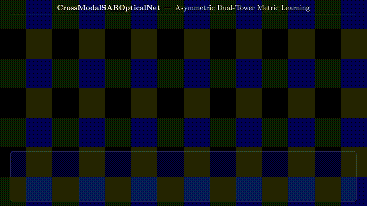
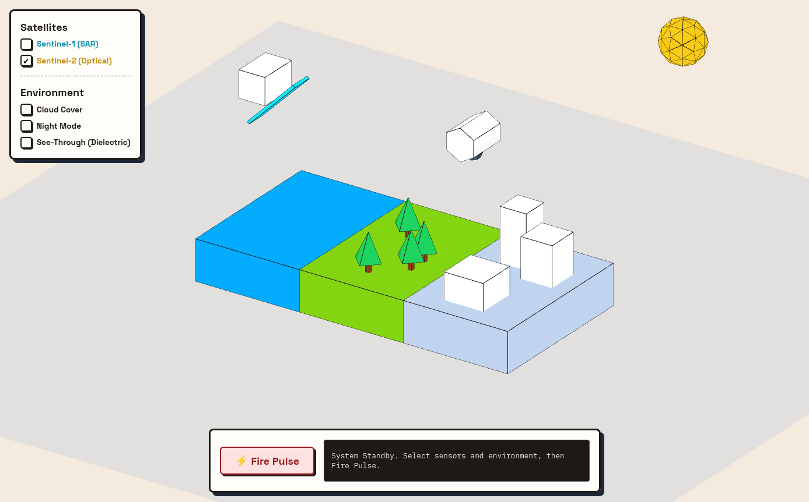
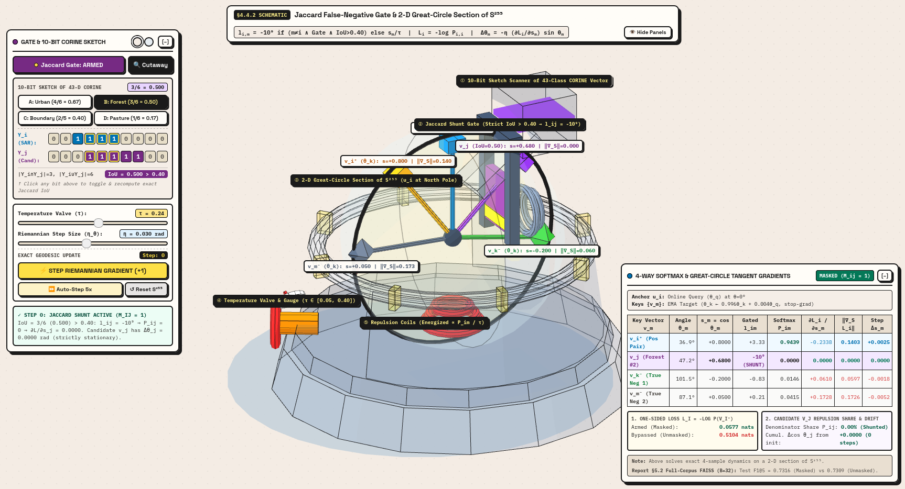

# Cross-Modal Satellite Image Retrieval

**Training pipeline:**

<a href="https://youtu.be/CJNlx6B8aKc">
  
</a>

## Interactive Demos

This is an attempt on visualizing the working physics and some parts of the architecture. click on demo name to read about them.

| Demo | Description | Preview | Live Link |
| :--- | :--- | :--- | :--- |
| [**Satellite Working**](./demos/satellite_working.md) | simulated workings of sentinel-1 and sentinel-2 | [](https://github.io) | [Launch Demo →](https://p-retrover.github.io/cross-modal-satellite-image-retrieval/demos/sentinel_1_vs_sentinel_2_isometric_technical_figure) |
| [**Masked InfoNCE Hypersphere Centrifuge**](./demos/centrifuge_demo.md) (incomplete) | Interactive 3D WebGL simulation of false-negative Jaccard gating ($\tau_{\text{IoU}} = 0.40$), Riemannian tangent-space gradients, and multi-label CORINE bitstream masking. | [](https://github.io) | [Launch Demo →](https://p-retrover.github.io/cross-modal-satellite-image-retrieval/demos/masked_infonce_centrifuge_jaccard_gate) |


## Sentinel-1 vs Sentinel-2 Interactive Visualization

This interactive 3D visualization demonstrates the working principles of two major Earth-observation satellite systems: Sentinel-1 (Synthetic Aperture Radar) and Sentinel-2 (Optical Imaging).

The simulation provides an intuitive view of how both satellites observe the same Earth surface using different sensing technologies.

### Key Features

- **Sentinel-1 SAR Simulation:** Visualizes radar signal transmission and return from the Earth's surface.
- **Sentinel-2 Optical Simulation:** Demonstrates optical satellite imaging and surface observation.
- **Interactive Controls:** Explore different simulation settings using buttons and sliders.
- **Day and Night Modes:** Switch between daytime and nighttime environments.
- **Cloud Cover:** Adjust cloud conditions to explore their visual impact.
- **Dielectric Mode:** Explore the dielectric-related simulation mode.
- **Animated Environment:** Includes moving clouds, pedestrians, and vehicles to create a more dynamic scene.
- **Terrain and Landscape:** Features a circular terrain environment with a river, waterfall, road, and simplified garden.

### Simulation Controls

Users can interact with the scene through the available controls, observe satellite operations, and pause or resume the animation.

The visualization is designed as an educational companion to the main research project, helping users understand the physical differences between SAR and optical satellite observations.

## Project Overview

## About the Dataset

The project leverages the **BigEarthNet-14K** dataset (Kaggle identifier: `narendraaironi/bigearthnet-14k`).

* **Volume:** 13,683 strictly co-registered Sentinel-1 and Sentinel-2 image pairs, totaling 27,366 TIFF images.


* **Splits:** Pre-partitioned into static geographic splits: 7,180 training, 3,255 validation, and 3,248 test samples.


* **Annotations:** Contains a `metadata.parquet` file detailing 43-class CORINE Land Cover multi-labels used for semantic Jaccard (IoU) masking.


## Repository Structure

The repository is organized to strictly separate the deep learning pipeline from the automated technical report generation pipeline.

```text
.
├── build/                                    # Compiled output directory
│   └── final_technical_report.pdf            # The compiled research article
├── build.sh                                  # Pandoc build script for the PDF
├── cross_modal_satellite_retrieval_sanitized.ipynb # Core training/eval notebook
├── ieee.csl                                  # IEEE citation style definition
├── images/                                   # Vector diagrams, ONNX graphs, and schemas
├── metadata.yaml                             # Pandoc metadata (author, title, date)
├── README.md                                 # Project documentation
├── references/                               # Source PDF literature
├── references.bib                            # BibTeX citations
├── sections/                                 # article chapters in Markdown
│   ├── 01_foundational_physics.md
│   ├── 02_literature_survey.md
│   ├── 03_data_engineering_and_preprocessing.md
│   ├── 04_neural_architecture_and_math.md
│   ├── 05_inductive_evaluation_and_faiss.md
│   ├── 06_results_ablations_and_diagnostics.md
│   ├── 07_appendices.md
│   └── 08_references.md
└── template.tex                              # XeLaTeX template for PDF rendering

```

## Where to Run (Training & Inference)

The deep learning pipeline is encapsulated in a single Jupyter Notebook optimized for cloud execution:

* **Environment:** [Google Colab](https://colab.research.google.com/)
* **Notebook:** `cross_modal_satellite_retrieval_sanitized.ipynb`
* **Hardware Requirement:** A single T4 or L4 GPU (16GB VRAM) is sufficient to train the model using Automatic Mixed Precision (AMP).
* **Setup:** Upload the notebook to Google Colab, ensure the runtime is set to GPU, and run the cells sequentially. The notebook automatically handles downloading the Kaggle dataset, extracting the TIFFs, and installing required dependencies (like `faiss-gpu` and `graphviz`).


## Compiling the Technical Report

The research article is written in modular Markdown and compiled into a publication-grade PDF using **Pandoc** and **XeLaTeX**.

### Prerequisites

Ensure you have Pandoc and a TeX distribution installed on your local machine (e.g., Fedora Linux):

```bash
sudo dnf install pandoc texlive-scheme-basic texlive-xetex

```

### Build Instructions

To compile the document, execute the provided bash script from the root of the repository:

```bash
chmod +x build.sh
./build.sh

```

The `build.sh` script concatenates the Markdown files in the `sections/` directory in numerical order, resolves the citations from `references.bib` using the `ieee.csl` style, and processes the typography via `template.tex`.

The final rendered article is automatically exported to `build/final_technical_report.pdf`.